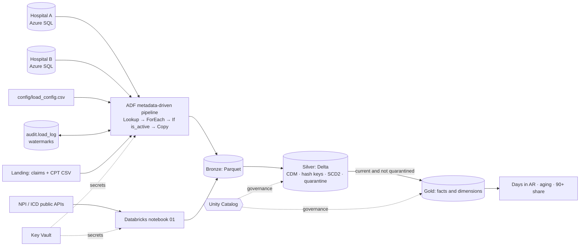

# Healthcare Revenue Cycle Management: Metadata-Driven Medallion Pipeline on Azure

A data platform design and reference implementation that consolidates **EMR data from two hospitals with different schemas**, insurance claims and public reference codes into governed fact and dimension tables, so finance can track **Days in AR**, **AR aging** and **accounts overdue by more than 90 days**.

## Table of contents
[Status](#project-status-and-scope) · [Problem](#business-problem) · [Architecture](#architecture) · [Data flow](#how-data-flows-end-to-end) · [Tech stack](#tech-stack-and-why) · [Concepts explained](#engineering-concepts-explained) · [KPIs](#kpi-definitions) · [Structure](#repository-structure) · [Run locally](#run-it-locally) · [Deploy](#deploy-to-azure-and-databricks) · [Testing](#testing-and-ci) · [Limitations](#limitations-and-next-steps) · [Glossary](#glossary)

## Project status and scope
- **What this is:** a reference implementation on **fully synthetic data**. No real patient information (PHI) is used anywhere; names, SSNs and phone numbers are fabricated.
- **Runs locally and in CI on every push:** the synthetic EMR generator, deterministic surrogate-key logic, declarative data-quality rules (rendered to both Python and Spark SQL) and unit tests.
- **Reference code for Azure/Databricks:** the PySpark notebooks, SCD2 library, KPI SQL, Bicep template and the Azure Data Factory specification are written to be deployed as described below; CI has no cloud workspace, so they are not executed by CI.
- **History:** the solution was originally built on free-trial Azure subscriptions that have since expired. ADF, Key Vault, ADLS and Azure SQL are therefore documented as designs (`docs/ADF_PIPELINE_SPEC.md`, `infra/main.bicep`).

## Business problem
A hospital stays financially healthy only if it gets paid promptly. The patient journey runs from appointment scheduling to final payment by insurers and patients, and the money still owed is **Accounts Receivable (AR)**. Finance needs reliable numbers: how long payment takes (**Days in AR**), how old the outstanding balances are, and which accounts (over 90 days) are likely to default. The data arrives from different systems: two hospitals' Azure SQL EMR databases with **different column names and overlapping IDs**, insurer claim files, and public code lookups.

## Architecture


## How data flows end to end
1. **Configure ingestion.** `config/load_config.csv` lists every source table: source database, table, `load_type` (full or incremental), watermark column and `is_active` (1/0).
2. **Ingest with one generic pipeline.** The ADF pipeline (spec in `docs/ADF_PIPELINE_SPEC.md`) reads the config, loops over tables **in parallel**, skips inactive ones, archives the previous file, then copies either everything (full) or only rows newer than the last stored watermark (incremental). Each table writes a row to `audit.load_log`.
3. **Land in Bronze.** Raw Parquet per hospital and table: the source of truth. Reference data (ICD-10 codes, NPI provider details) comes from public APIs via notebook `01_ingest_reference_apis.py`.
4. **Standardise in Silver.** `02_bronze_to_silver_cdm.py` maps each hospital's columns to a **Common Data Model**, adds a deterministic **surrogate key** (`sha256(hospital_id‖natural_id)`), hashes the SSN with a secret salt (the raw SSN never reaches Silver), flags invalid rows (`is_quarantined` + `quarantine_reason`), tracks history with **SCD Type 2**, and upserts transactions idempotently.
5. **Publish Gold.** `03_silver_to_gold.py` keeps only current, non-quarantined rows; `sql/gold_kpis.sql` defines the KPI views.

## Tech stack and why
| Tool | Role | Why |
|---|---|---|
| Azure Data Factory | Ingestion, orchestration | Parameterised pipelines, built-in connectors, parallel ForEach |
| ADLS Gen2 | Lake storage | Hierarchical namespace, cheap storage for Parquet/Delta |
| Azure Databricks (PySpark, Delta) | Transformations | Complex logic (CDM mapping, SCD2) that ADF is not suited for; ACID MERGE |
| Azure Key Vault | Secrets | No credentials in code |
| Unity Catalog | Governance | Central access control, lineage |
| Bicep | Infrastructure as code | Repeatable storage, Key Vault, ADF deployment |

## Engineering concepts explained
**Metadata-driven pipeline.** Instead of one pipeline per table, one pipeline reads a config file. Adding a table is one CSV row; setting `is_active=0` pauses a table without a code change. Trade-off: config mistakes surface at run time, so keep the file under version control.

**Audit table without an identity column.** An auto-incrementing key forces inserts to serialise, which silently turned parallel ingestion into sequential ingestion. `audit.load_log` is keyed by `(run_id, source_db, table_name)` instead (`sql/audit_table.sql`). It also stores the maximum watermark that drives the next incremental load.

**Common Data Model with collision-safe keys.** Hospital A uses `PatientID`, Hospital B `patient_id`, and both start counting at 1. `src/lib/keys.py` hashes `hospital_id‖natural_id`, so key 1 in A and key 1 in B differ, reruns and backfills produce the same keys, and no coordination between writers is needed. Trade-off: 64-character keys join slower than integers; a BIGINT key can be assigned once in Gold for BI.

**Hash-diff SCD Type 2 (`src/lib/scd2.py`).** To preserve history (for example a patient's address), a hash of the tracked columns is compared to detect a change. One Delta `MERGE` closes the old version (`is_current=false`) and inserts the new version in the same transaction; running it twice adds nothing. Limitation: it assumes records arrive in order.

**Declarative data-quality rules (`src/lib/quality.py`).** Each rule is defined once (for example `{"col": "first_name", "check": "not_blank"}`) and rendered to a Spark SQL expression for the pipeline and to Python for tests, so the tested rule is the rule that runs. Failing rows are **quarantined with reason codes**, not deleted, and Gold excludes them. A DQ metrics table records the quarantine rate per run.

**PII minimisation.** SSNs are salted and hashed; the salt comes from a Key Vault-backed secret scope. (This demonstrates the pattern; real PHI additionally requires organisational HIPAA controls.)

**Infrastructure as code.** `infra/main.bicep` declares a storage account with hierarchical namespace and four containers, a Key Vault with RBAC and an ADF instance with a managed identity.

## KPI definitions
- **Outstanding** = `amount − paid_amount` where positive.
- **Days in AR** = total outstanding AR ÷ (charges in the last 90 days ÷ 90).
- **Aging buckets** = 0-30, 31-60, 61-90 and 90+ days since service date.
- **AR over 90 days** = share of outstanding AR older than 90 days.
All three are defined in `sql/gold_kpis.sql`.

## Repository structure
```
├── config/load_config.csv            # metadata driving ingestion
├── docs/                             # ADF pipeline spec, design decisions
├── infra/main.bicep
├── notebooks/                        # 01 reference APIs · 02 bronze→silver CDM · 03 silver→gold
├── sql/                              # audit table DDL, KPI views
├── src/
│   ├── generators/generate_emr_data.py
│   └── lib/                          # keys.py · quality.py · scd2.py
├── tests/                            # 7 unit tests
└── .github/workflows/ci.yml
```

## Run it locally
Python 3.10+, no packages required.
```bash
python -m src.generators.generate_emr_data --out data     # two hospitals + claims + CPT codes
python -m unittest discover -s tests -t . -v
```
The generator deliberately creates different schemas per hospital, overlapping IDs, and three patients with blank names so the CDM, key and quarantine logic have something to prove.

## Deploy to Azure and Databricks
1. Deploy infrastructure: `az deployment group create -g <resource-group> -f infra/main.bicep`, then grant the ADF managed identity *Storage Blob Data Contributor* and *Key Vault Secrets User*.
2. Create the ADF pipeline following `docs/ADF_PIPELINE_SPEC.md`; create `audit.load_log` from `sql/audit_table.sql`.
3. In Databricks, create a Key Vault-backed secret scope (default name `rcm-kv`) containing `ssn-salt`; create catalog `rcm` with schemas `bronze`, `silver`, `gold`, `audit` (and `audit.dq_metrics`).
4. Run the notebooks in order; then run `sql/gold_kpis.sql`.
Notebook configuration (Spark conf): `bronze_path`, `catalog`, `secret_scope`.

## Testing and CI
Seven unit tests check: hospitals' schemas differ while their IDs collide; surrogate keys never clash and are deterministic; seeded dirty rows exist; SQL and Python rule renderers cover the same rules; blank and null values are quarantined with correct reason codes; SQL flags are null-safe. GitHub Actions byte-compiles and runs the tests on each push.

## Limitations and next steps
- SCD2 assumes in-order arrival; late-arriving history needs a rewrite-history pattern.
- Claims are generated and landed but the denial-rate view is left as a documented query.
- Add Spark-based tests in CI and Unity Catalog row filters by hospital.

## Glossary
**RCM:** revenue cycle management. **AR:** accounts receivable. **EMR:** electronic medical record. **CDM:** common data model. **SCD2:** slowly changing dimension type 2 (keeps history). **Watermark:** the high-water mark used to load only new rows. **Quarantine:** keeping invalid rows aside with reasons. **HNS:** hierarchical namespace in ADLS Gen2.
